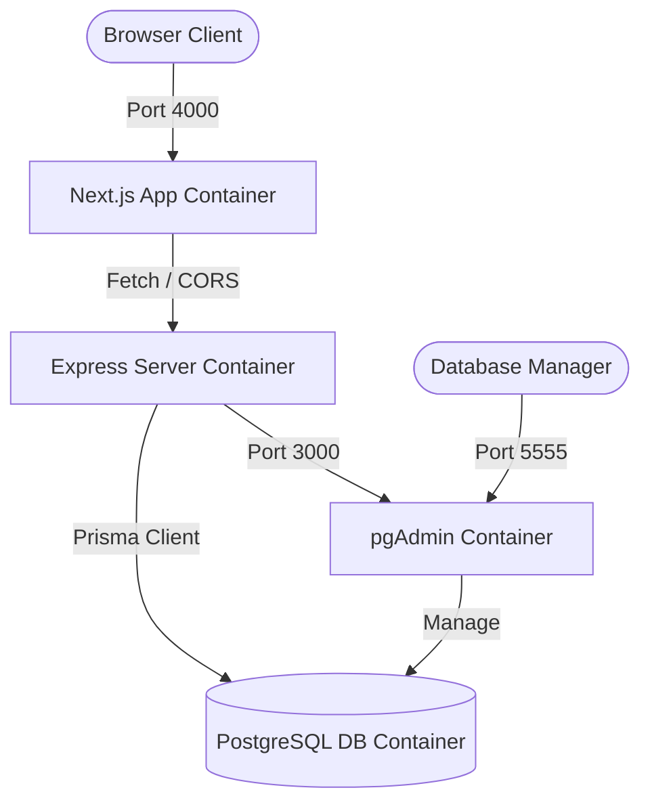

# 💄 SI-K-Beauty — International Cosmetics E-Commerce Platform

Sikbeauty is a premium, multilingual, role-based international e-commerce platform dedicated to high-end cosmetic and beauty products. Engineered for retail and wholesale, the application dynamically adjusts prices, catalogs, tax rates, and checkout payment solutions based on the user's geographical location and customer profile.

---

## 🏗️ System Architecture Overview

The system is architected as a decoupled monorepo containing two core services operating inside a seamless orchestrator network:

```
sikbeauty-next/
├── app/                 # Next.js 16 (App Router) + React 19 Frontend
├── server/              # Express.js + TypeScript + Prisma ORM Backend API
├── docker-compose.yml   # Multi-container Docker orchestrator config
└── README.md            # Global Project documentation (this file)
```

### 🛰️ Container Orchestration Map


---

## 🌐 Elite Feature Set

### 🧑‍💼 Multi-Tiered User Roles & Accounts
* **Simple Client (Retail):** Standard B2C purchasing flow. Customers see retail prices and purchase items normally.
* **Professional Account (Wholesale B2B):** Verified business partners who benefit from dynamic, discounted wholesale pricing structures.
* **Admin Administrator:** A robust operational dashboard to oversee products, manage category hierarchies, alter statuses, view customer profiles, and manage incoming orders.

### 🗺️ Geo-Targeted Multi-Currency & Payment Workflows
* 🇲🇦 **Inside Morocco:** Checkout transactions default to standard **Cash-on-Delivery (COD)**.
* 🌍 **Outside Morocco:** Transactions transition dynamically to **Stripe API** for secure international credit/debit card processing.

### 🗣️ Seamless Multilingual Support
Native locale switching across three major languages:
* **Arabic** (العربية) 🇲🇦
* **French** (Français) 🇫🇷
* **English** (English) 🇬🇧

---

## ⚙️ Global Technical Stack

| Category | Technology | Purpose |
| :--- | :--- | :--- |
| **Frontend** | React 19 + Next.js 16 (App Router) | High-speed component rendering, SEO-optimized metadata, static/SSR pages. |
| **Frontend Styling** | Vanilla CSS + PostCSS + Tailwind | Fully custom, fluid luxury beauty aesthetic with subtle micro-animations. |
| **Backend** | Node.js + Express.js + TypeScript | High-performance RESTful API with rigid TypeScript boundaries. |
| **Database ORM** | PostgreSQL + Prisma ORM | Relational relational persistence with automated migrations and safety schemas. |
| **Authentication** | HTTP-Only Cookies + JWT | Top-tier security against XSS/CSRF attacks for active user sessions. |
| **Integrations** | Stripe SDK + libphonenumber-js | International credit card processing and real-time smart phone validation. |

---

## 🚀 Rapid Development Setup (Docker Compose)

The entire environment is orchestrated via Docker Compose. Ensure you have **Docker** and **Docker Compose** installed.

### 1️⃣ Clone the Repository & Configure Env
```bash
git clone https://github.com/LatrachDev/Sikbeauty.git
cd Sikbeauty
```
Create a `.env` file in the root workspace folder matching the following configurations:
```ini
PORT=4000
DATABASE_URL="postgresql://postgres:postgres@db:5432/postgres"
POSTGRES_DB=postgres
POSTGRES_USER=postgres
POSTGRES_PASSWORD=postgres
POSTGRES_PORT=5432
PGADMIN_DEFAULT_EMAIL="admin@example.com"
PGADMIN_DEFAULT_PASSWORD=password
PGADMIN_PORT=5555
```

### 2️⃣ Build and Boot the Containers
```bash
docker compose up --build -d
```
Docker will pull the images, construct the client and API images, generate the Prisma Client, run migrations, seed the database, and spin up four healthy containers:

| Container | Service Name | Accessible Address |
| :--- | :--- | :--- |
| **Next.js Client** | `next_app` | [http://localhost:4000](http://localhost:4000) |
| **TypeScript API** | `back-end` | [http://localhost:3000](http://localhost:3000) |
| **PostgreSQL Database** | `postgres_db` | `localhost:5432` |
| **pgAdmin Interface** | `pgadmin` | [http://localhost:5555](http://localhost:5555) |

### 3️⃣ Useful Workspace Commands
```bash
# View active container status
docker compose ps

# Access live logs
docker compose logs -f

# Access backend container shell
docker compose exec server bash

# Access frontend container shell
docker compose exec app bash

# Shut down the ecosystem preserving db volumes
docker compose down
```

---

## 🛡️ Security & Authentication Architecture
Sikbeauty is hardened with enterprise-grade **HTTP-Only Cookie-based Authentication**:
* Tokens are signed as JWT payloads, then set by the backend server inside `HttpOnly`, `Secure` (in production), and `SameSite: Lax` cookies.
* This completely insulates active user sessions from malicious JavaScript XSS (Cross-Site Scripting) theft.
* CORS (Cross-Origin Resource Sharing) is configured explicitly between `http://localhost:4000` (Next.js) and `http://localhost:3000` (Express Server) with `credentials: true` enabled.

---

## 👨‍💻 Primary Authors

* **Mohammed Latrach** — *Full Stack Developer & Art Lead* — [GitHub](https://github.com/LatrachDev) | [LinkedIn](https://linkedin.com/in/latrachdev)
* **Marouane ADDOU** — *Software Architect* — [GitHub](https://github.com/marouaneaddou) | [LinkedIn](https://linkedin.com/in/marouaneaddou/)

---

## 🪪 License
This platform is licensed under **LANDMARK AGENCY**. All rights reserved.
